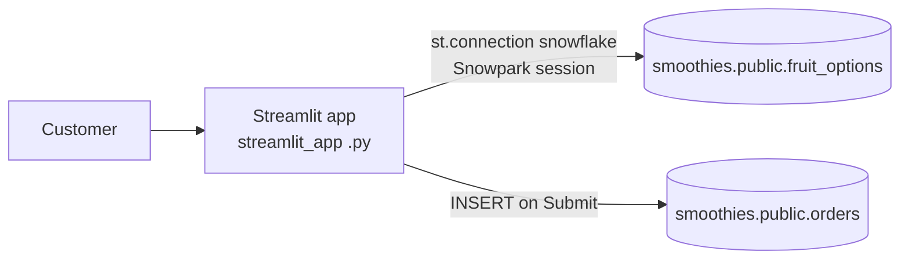

# Melanie's Smoothies — Streamlit in Snowflake

A small Streamlit order form backed by Snowflake. A customer enters a name, picks smoothie ingredients from a fruit list stored in Snowflake, and submits. The order is written to an `orders` table through Snowpark.

## Architecture



## Tech stack

Python · Streamlit · Snowflake · Snowpark for Python

## What it demonstrates

- Connecting Streamlit to Snowflake with `st.connection("snowflake")` and a Snowpark session
- Populating a `multiselect` straight from a Snowflake table
- Writing user input back to Snowflake on a button click
- A Dev Container config for one-click setup in GitHub Codespaces

## Project structure

```
.
├── streamlit_app .py        # the app
├── requirement.txt          # dependencies
└── .devcontainer/           # Codespaces / VS Code dev container
```

## How to run

1. In Snowflake, create the database `SMOOTHIES`, a `PUBLIC.FRUIT_OPTIONS (FRUIT_NAME)` table with some fruits, and a `PUBLIC.ORDERS (INGREDIENTS, NAME_ON_ORDER)` table.
2. Add your Snowflake connection details to `.streamlit/secrets.toml` under `[connections.snowflake]`. Don't commit that file.
3. Install and run the app:
   ```bash
   pip install "streamlit[snowflake]"
   streamlit run "streamlit_app .py"
   ```
   Or paste the code into a **Streamlit in Snowflake** app.

## Possible next steps

- Use a parameterised insert instead of building the SQL string by concatenation; this removes the SQL-injection risk
- Enforce the "up to 5" limit with `max_selections=5`
- Fix the typo in `requirement.txt` (`snowflake-snoepark-python` → `snowflake-snowpark-python`)
- Rename `streamlit_app .py` to remove the space
